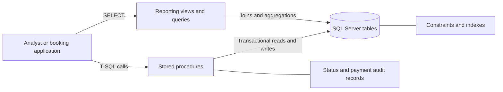
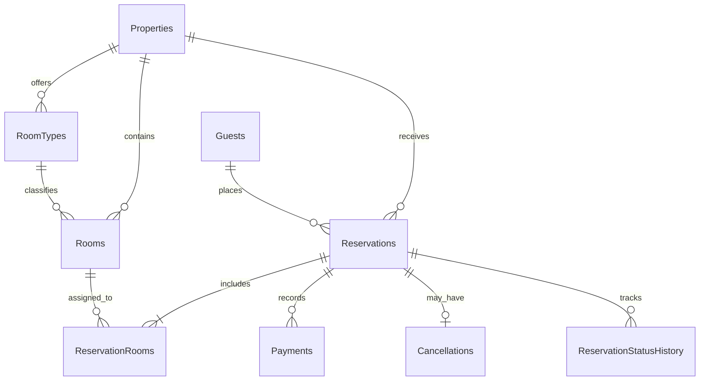

# Travel Booking and Hotel Availability Management System

**A Microsoft SQL Server and T-SQL portfolio project** for hotel inventory, room availability, reservations, payments, cancellations, and booking changes.

The project models three fictional hotel properties and demonstrates a practical relational design, concurrency-safe booking procedures, audit history, and reusable operational reports.

## At a glance

| Area | Included |
|---|---|
| Database | SQL Server 2019+, normalized relational schema, keys, checks, and indexes |
| Inventory | Properties, room types, rooms, date-based availability, multi-room stays |
| Booking | Create, add rooms, change dates, cancel, and record reservation status history |
| Finance | Charge/refund ledger, unique idempotency keys, refund limits |
| Reporting | Occupancy, property revenue, cancellations, lead time, room demand, arrivals/departures |
| Examples | Fictional seed data and a separate workflow test script |

## Architecture

The repository contains the SQL data layer and example queries. An application or SQL client calls the stored procedures and views; no web or desktop booking application is included.



The booking procedures lock the selected room inventory before checking date overlaps and writing reservations. The date interval is half-open: `[check-in, check-out)`, so a room can be booked by the next guest on the same day the prior guest checks out.

See [docs/ARCHITECTURE.md](docs/ARCHITECTURE.md) for the booking flow and [docs/ER_DIAGRAM.md](docs/ER_DIAGRAM.md) for the full entity relationship diagram.

## Data model



Each reservation belongs to one guest and property and can include multiple rooms. Reservation dates are stored once and apply to each assigned room. Charges and refunds are separate immutable payment ledger entries; cancellations and status transitions have dedicated audit records.

## Setup

### Requirements

- SQL Server 2019 or later
- SQL Server Management Studio (SSMS), Azure Data Studio, or `sqlcmd`
- A login that can create `TravelBookingDB`

### Run the scripts

Open the repository in SSMS or Azure Data Studio, connect to your SQL Server instance, and execute each setup script in order:

| Order | Script | Purpose |
|---:|---|---|
| 1 | [`sql/00_database.sql`](sql/00_database.sql) | Create and select `TravelBookingDB` |
| 2 | [`sql/01_tables.sql`](sql/01_tables.sql) | Create tables, keys, defaults, and checks |
| 3 | [`sql/02_indexes.sql`](sql/02_indexes.sql) | Add search and reporting indexes |
| 4 | [`sql/03_seed_data.sql`](sql/03_seed_data.sql) | Load fictional properties, rooms, guests, and bookings |
| 5 | [`sql/04_procedures.sql`](sql/04_procedures.sql) | Create availability, booking, payment, and cancellation procedures |
| 6 | [`sql/05_views.sql`](sql/05_views.sql) | Create financial, cancellation, and upcoming-stay views |
| 7 | [`sql/06_reports.sql`](sql/06_reports.sql) | Run example management reports |

Each SQL file selects `TravelBookingDB`. Run the seed script once per fresh database. To use an existing database, update the database name in the scripts and omit the database creation script.

## Sample workflow

Availability search returns currently available `RoomID` values that fit the party:

```sql
EXEC dbo.usp_SearchAvailability
    @PropertyID = 1,
    @CheckInDate = '2027-06-10',
    @CheckOutDate = '2027-06-13',
    @GuestCount = 2;
```

Create a reservation using one or more comma-separated room IDs from the search result. In the seed data, room number `101` has `RoomID = 1`:

```sql
DECLARE @ReservationID int;

EXEC dbo.usp_CreateReservation
    @GuestID = 1,
    @PropertyID = 1,
    @CheckInDate = '2027-06-10',
    @CheckOutDate = '2027-06-13',
    @GuestCount = 2,
    @RoomIDs = N'1',
    @IdempotencyKey = 'demo-booking-001',
    @ReservationID = @ReservationID OUTPUT;

EXEC dbo.usp_RecordPayment @ReservationID, 300.00, 'USD', 'demo-payment-001', N'Card deposit';
```

Other procedures include `usp_AddRoomsToReservation`, `usp_ModifyReservationDates`, `usp_CancelReservation`, and `usp_ProcessRefund`. Example IDs and dates are illustrative; availability can change as reservations are created.

## Business rules and safeguards

- Check-out must be later than check-in; guest count, payment, and refund amounts must be positive.
- Each room's capacity must accommodate the full reservation guest count.
- Confirmed and checked-in reservations occupy inventory. Cancelled and checked-out stays do not block dates.
- The create, add-room, and date-change procedures validate overlaps inside transactions while locking room rows in a stable order.
- Cancellation is allowed only for a confirmed stay before its check-in date and writes cancellation and status history together.
- Payments require a confirmed or checked-in reservation. A unique idempotency key prevents replaying a payment or refund request.
- Refunds are append-only ledger entries and cannot exceed the amount charged in the same currency.
- SQL Server has no simple unique constraint for overlapping date ranges. Applications should restrict direct writes to reservation-room assignments and use the stored procedures.

## Reports

[`sql/06_reports.sql`](sql/06_reports.sql) includes:

- Monthly occupancy rate from occupied room-nights / available room-nights
- Gross charges, refunds, and net revenue by property and month
- Cancellation counts and booking lead time
- Booking lead time rankings with window functions
- Room-type demand, room-nights, and booked room value
- Upcoming check-ins and check-outs

The reports demonstrate joins, aggregations, CTEs, window functions, correlated subqueries, and date calculations. Occupancy is an estimate based on active inventory and assigned reservation nights.

## Test scenarios

After setup, run [`tests/01_workflow_tests.sql`](tests/01_workflow_tests.sql) to exercise successful bookings and room additions, unavailable and overlapping rooms, invalid dates, over-capacity guests, date changes, duplicate payment keys, cancellation, and refunds. It removes the test records it creates when it completes. Run it against a disposable development database.

## Repository map

```text
sql/       Ordered database, table, index, seed, procedure, view, and report scripts
tests/     Booking and payment workflow checks
docs/      ER diagram and architecture notes
README.md  Setup, workflow, and project overview
```

All hotel properties and guest records are fictional.

## Interview discussion

- **Schema design:** core entities are separated and linked by foreign keys; reservation-room assignments support multi-room bookings without copying inventory data.
- **Availability:** a conflict exists when `existing.CheckInDate < requested.CheckOutDate AND existing.CheckOutDate > requested.CheckInDate` for a room with an active reservation.
- **Concurrency:** procedures lock relevant room rows before checking availability, so competing requests for the same room are serialized.
- **Auditability:** status changes and payments/refunds are recorded as dated events; refund entries do not overwrite charges.
- **Indexes and reporting:** targeted indexes support property/date/status searches and ledger lookup; reports turn booking events into operational and revenue measures.
