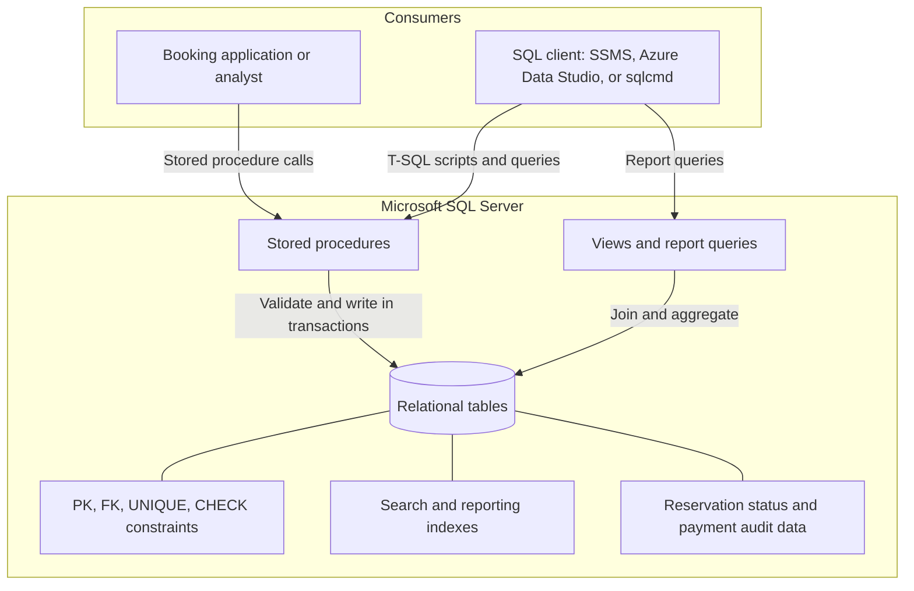
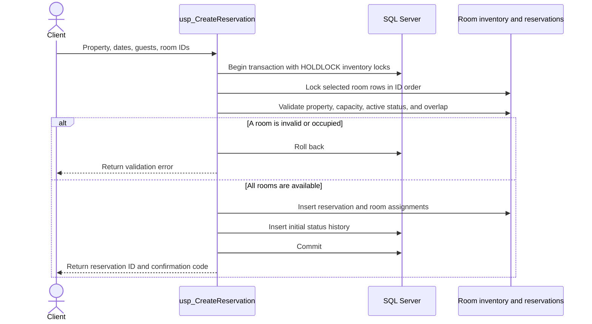

# System architecture

This project provides a SQL Server data layer. A user or future booking application invokes stored procedures for writes and queries views/reports for reads. It does not include an application server, website, or user interface.

## Components

## Reservation creation flow

The same inventory locking and overlap rule is used when rooms are added or reservation dates are changed. The half-open interval rule treats checkout as unoccupied, allowing same-day turnover. Payment and refund procedures lock the reservation and validate ledger totals before inserting their audit entry.

## Data flow

1. A client searches using `usp_SearchAvailability` for a property, date range, and party size.
2. The client submits selected `RoomID` values to `usp_CreateReservation`.
3. The procedure locks inventory, checks availability, writes the reservation and its room assignments, and appends the initial status event.
4. Payment, cancellation, and refund procedures append financial or cancellation audit records and update reservation status where applicable.
5. Views and report queries aggregate reservation, inventory, and payment events for operations and analysis.
